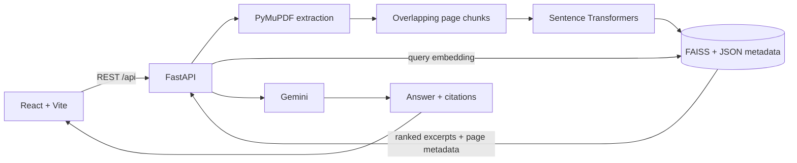

# SmartDocs RAG

SmartDocs is a local document research assistant. Upload PDFs, ask questions across your library, and review page-level source excerpts alongside each answer.

## Features

- PDF text extraction with PyMuPDF, page provenance, file metadata, and clear handling for invalid, empty, and scanned PDFs.
- Overlapping text chunks embedded with `all-MiniLM-L6-v2` and indexed in a persistent FAISS cosine-similarity store.
- Gemini grounded answers with source citations, plus a retrieved excerpt fallback when no Gemini key is configured.
- Multi-file uploads, document listing and deletion, health metrics, and an interactive OpenAPI page.
- Responsive React interface for document management and source-backed chat.

## Architecture



## Requirements

- Python 3.10 or newer
- Node.js 18 or newer
- Optional Gemini API key for synthesized answers (retrieval works without it)

## Run locally

From the repository root, create a virtual environment and install the backend dependencies:

```powershell
py -m venv .venv
.\.venv\Scripts\Activate.ps1
pip install -r backend/requirements.txt
Copy-Item .env.example .env
```

Edit `.env` and set `GEMINI_API_KEY` to enable Gemini. Then start the API:

```powershell
python -m uvicorn backend.main:app --reload
```

The API listens on `http://localhost:8000`; interactive documentation is at `/docs`.

In another terminal, start the frontend:

```powershell
cd frontend
npm install
npm run dev
```

Open the Vite URL, usually `http://localhost:5173`. Set `VITE_API_URL` if the API uses a different URL; the default is `http://localhost:8000/api`.

The first document upload may download the Sentence Transformers model. Stored uploads and FAISS metadata remain in `backend/storage/` and are ignored by Git.

## RAG workflow

1. Upload one or more PDF files. PyMuPDF extracts text page by page and warns when no selectable text is available (scanned PDFs need OCR before indexing).
2. The splitter creates overlapping chunks with document and page metadata.
3. Sentence Transformers generates normalized embeddings; FAISS persists vectors and JSON stores chunk provenance.
4. Each question is embedded and matched against the index. The top relevant excerpts are supplied to Gemini with instructions to answer from context only.
5. The response includes citations with filename, page number, excerpt, and similarity score. If Gemini is not configured, the API returns the best retrieved excerpt instead.

## API

Both root paths and `/api` paths are available.

| Method | Path | Purpose |
| --- | --- | --- |
| `POST` | `/api/upload` | Upload PDFs as multipart field `files` (repeat for multiple files) |
| `POST` | `/api/chat` | JSON body: `{ "query": "...", "top_k": 4, "session_id": "optional" }` |
| `GET` | `/api/documents` | List indexed documents |
| `DELETE` | `/api/documents/{document_id}` | Delete a document and rebuild the index |
| `DELETE` | `/api/documents` | Clear all documents and indexes |
| `GET` | `/api/health` | Service, index, and Gemini status |

Example questions: “What are the main recommendations?”, “Compare the stated risks across these reports”, and “Which page describes the renewal terms?”

## Configuration

See `.env.example` for Gemini, embedding device/model, chunk size/overlap, retrieval count, score threshold, and server settings. The API currently permits browser origins on localhost ports 5173 and 3000.

## Tests

```powershell
python -m pytest -q
```

Tests cover settings, PDF processing, chunking, embeddings, FAISS persistence and deletion, RAG behavior, and API routes.

## Limitations and next steps

- Scanned PDFs are detected but OCR is not built in.
- Chat history is in-memory and resets when the backend restarts.
- Gemini answers require a key and network access; the local retrieval fallback is available without it.
- The document library is a single-user local service. Add authentication and per-user storage before deployment.
- Further work: persistent conversations, OCR integration, retrieval evaluation, hybrid search, and production deployment hardening.

## Screenshots

No screenshots are checked in yet. Run the application locally to capture the live interface.
